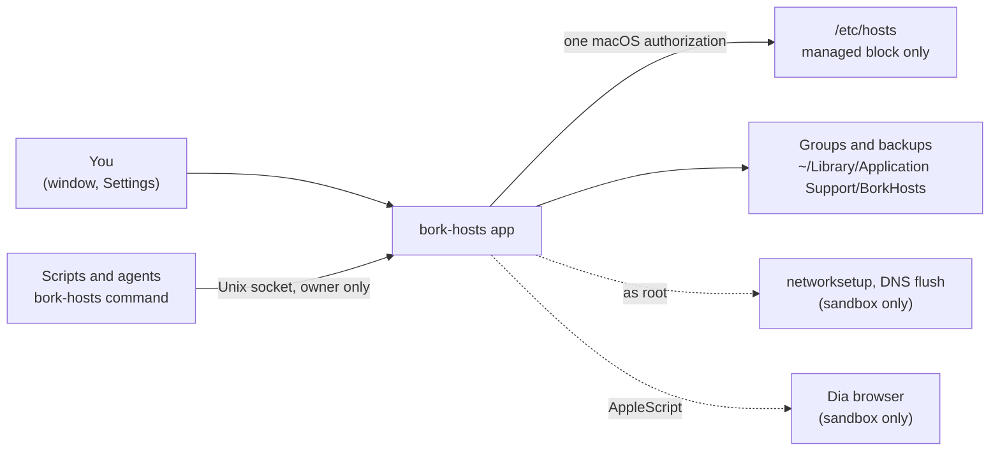

# bork-hosts

**A macOS app for turning groups of `/etc/hosts` lines on and off, with an optional one-switch sandbox and a command that lets scripts and coding agents drive it.**

[Quick start](#quick-start) · [Requirements](#requirements) · [Optional features](#optional-features) · [Configuration](#configuration) · [Documentation](#documentation) · [Troubleshooting](#troubleshooting) · [Contributing](CONTRIBUTING.md)

bork-hosts is a SwiftUI app and a small command-line tool. You keep named groups of hosts lines ("staging", "local dev", "blocked sites"), and each group, or each line in it, is a switch. The app edits only a block it owns in `/etc/hosts` and leaves every other line in the file alone.

- **Switch groups and lines.** One click turns a whole group on or off, or a single line. Only one IP is ever enabled for a hostname; turning on a line that clashes turns the old one off and tells you.
- **Stay safe with a root-owned file.** Every write is checked against what the app last read, backed up first, and refused if anything outside its block would change. See [Safety model](docs/security.md).
- **Optional sandbox switch.** One toggle turns two groups on or off, adds a host to your proxy bypass list, flushes DNS, clears the Dia browser's caches, points your MCP servers (Claude Code, Codex, Grok) at the sandbox, runs a command on the sandbox over ssh, and checks that the sandbox answers. Off until you enable it in Settings, and its settings can be exported and imported. See [Sandbox switch](docs/sandbox.md).
- **Let agents and scripts drive it.** `bork-hosts group on "staging"` works from a shell, Claude Code, Codex or anything else, without letting them add, edit or delete anything. See [Agents and scripts](docs/agents.md).

## How it fits together



Solid lines are the core. Dashed lines belong to the sandbox switch and exist only when you turn it on. The command never touches `/etc/hosts` itself; it asks the running app, which does the work with its own authorization.

## Requirements

| Component                                       | Required?    | What it gives you                                                     |
| ----------------------------------------------- | ------------ | --------------------------------------------------------------------- |
| macOS 14 or later                               | **Required** | The platform the app runs on                                          |
| Swift 6 toolchain (Xcode 16 or later)           | **Required** | Builds the app and the command (`swift build`, `swift test`)          |
| An administrator account                        | **Required** | Writing `/etc/hosts` needs a password or Touch ID approval            |
| The Dia browser                                 | Optional     | The two cache-clearing steps of the [sandbox switch](docs/sandbox.md) |
| A network service name such as `Wi-Fi`          | Optional     | The proxy bypass step of the sandbox switch                           |

Nothing optional is on until you enable it.

## Quick start

This takes you from a fresh clone to a group you can switch on and off.

### 1. Build the app

```sh
git clone https://github.com/borkweb/bork-hosts.git
cd bork-hosts
bash scripts/build-app.sh
```

The script builds `build/BorkHosts.app` and the `bork-hosts` command inside it. The bundle is signed ad hoc, for personal use, with no Developer ID and no notarization, so macOS may ask you to approve it the first time you open it.

### 2. Open it

```sh
open build/BorkHosts.app
```

### 3. Add a group

Choose **Add Group**, give it a name, and paste hosts lines, one per line:

```text
192.0.2.10 example.com
192.0.2.10 api.example.com
```

macOS asks you to authenticate, and the group is switched on. The right-hand pane shows `/etc/hosts` as it is on disk, with the lines you enabled highlighted.

### 4. Switch it off and on

Click the group's switch. Changes made within about five minutes of that first approval need no dialog. Your own lines outside the managed block are never touched.

### 5. Check it from the command line

```sh
ln -sf "$PWD/build/BorkHosts.app/Contents/MacOS/bork-hosts" ~/bin/bork-hosts   # any folder on your PATH
bork-hosts groups
```

You should see each group, its lines and whether each is `on`, `off` or `missing`. If the app is not running, the command starts it. If something is off, see [Troubleshooting](#troubleshooting).

## Optional features

### Sandbox switch

A single switch for a setup where a development server sits behind a SOCKS proxy: it turns a main group and an API group on or off, adds a host to the network service's proxy bypass list, flushes DNS, and clears the Dia browser's host cache and socket pools. It can also route the MCP servers in Claude Code, Codex and Grok through your SOCKS proxy, run a command on the sandbox over ssh, and check that the sandbox answers. Open **Settings** (Cmd-,), turn on **Show the sandbox panel**, and set your two group names, the host and the network service. Full guide: [Sandbox switch](docs/sandbox.md).

### Agents and scripts

The `bork-hosts` command sends requests to the running app over a Unix socket that only your user can open:

```sh
bork-hosts status
bork-hosts group on|off "<group name>"
bork-hosts line on|off <hostname> [--group "<group name>"]
bork-hosts sandbox on|off [--no-api]
```

Agents can switch existing groups and lines. They cannot add, edit, rename or delete them, and they cannot run commands as root. Full guide, including the JSON output and exit codes: [Agents and scripts](docs/agents.md).

## Configuration

The app has no config file. Preferences live in the Settings window and in macOS user defaults; data lives in two folders.

| Setting or path                                    | Purpose                                                                    |
| -------------------------------------------------- | -------------------------------------------------------------------------- |
| Settings, **Show the sandbox panel**               | Turns the sandbox switch on. Off by default.                               |
| Settings, group names, host, network service       | What the sandbox switch acts on. Blank or generic by default; each blank step is skipped. |
| `~/Library/Application Support/BorkHosts/groups.json` | Your groups and lines                                                   |
| `~/Library/Application Support/BorkHosts/backups/` | The newest 20 copies of `/etc/hosts`, one per write                        |
| `~/Library/Application Support/BorkHosts/agent.sock`  | The socket the `bork-hosts` command talks to                            |
| `~/Library/Logs/BorkHosts/sandbox.log`             | One line per sandbox step, for runs that go by too fast to read            |

The full list, with the defaults keys, is in [Configuration](docs/configuration.md).

## Documentation

**Using bork-hosts**

- [Groups and the managed block](docs/groups.md): how groups map to `/etc/hosts`, the one-IP-per-hostname rule, backups, and what happens when the file changes under you
- [Sandbox switch](docs/sandbox.md): the eight steps, Settings, MCP servers, and enabling Dia scripting
- [Agents and scripts](docs/agents.md): the command, JSON output, exit codes and the trust boundary

**Reference**

- [Configuration](docs/configuration.md): every setting, defaults key, file and log
- [Safety model](docs/security.md): what runs as root, how writes are verified, and what is and is not protected

**Working on bork-hosts**

- [Contributing](CONTRIBUTING.md): scope, layout, checks and pull requests

## Troubleshooting

| Symptom                                                    | Cause and fix                                                                                                                                                                          |
| ---------------------------------------------------------- | -------------------------------------------------------------------------------------------------------------------------------------------------------------------------------------- |
| "Authentication was cancelled."                            | You dismissed the macOS dialog, so nothing was written. Try the change again and approve it.                                                                                           |
| "The hosts file changed while it was being updated."       | Something else edited `/etc/hosts` during the write. The app retries once; if it still fails, nothing was written, so try the change again.                                           |
| A message about a `# BEGIN: bork-hosts` or `# END` marker  | The managed block's markers are missing, duplicated or out of order. Nothing was changed. Fix the markers by hand in `/etc/hosts`; see [Groups](docs/groups.md#the-managed-block).    |
| "The hosts file has no enabled localhost entry"            | The app refuses to write a file without a working `localhost` line. Restore `127.0.0.1 localhost` and try again.                                                                      |
| "Turned off 192.0.2.20 example.com" after switching a line on | Only one IP can be enabled for a hostname, so the older line was turned off. See [Groups](docs/groups.md#one-ip-per-hostname).                                                         |
| A group shows a mixed state                                | Some of its lines are on and some are off. Click it to turn them all on.                                                                                                               |
| The sandbox panel and toolbar button are missing           | The sandbox is off until you enable it: open Settings (Cmd-,) and turn on **Show the sandbox panel**.                                                                                  |
| `bork-hosts sandbox on` says the switch is "turned off"    | Same cause. An agent cannot enable it for you; turn it on in Settings.                                                                                                                 |
| The sandbox says "No network service is set"               | Enter the service (for example `Wi-Fi`) in Settings. List yours with `networksetup -listallnetworkservices`.            |
| The two Dia steps show "skipped"                           | Dia was not started with `--enable-applescript-javascript`, or is not running. That is not a failure. See [Enabling Dia scripting](docs/sandbox.md#enabling-dia-scripting).           |
| A sandbox step fails and the rest do not run               | Steps run in order and stop at the first failure; nothing done is rolled back. The failed row says why, and `~/Library/Logs/BorkHosts/sandbox.log` has the detail.                    |
| `bork-hosts` exits 3                                       | The app could not be reached. Open it, or drop `--no-launch`. See [exit codes](docs/agents.md#exit-codes).                                                                            |
| `bork-hosts` exits 4 or waits a long time                  | The macOS dialog is waiting for you. Approve it and run the command again.                                                                                                             |
| `bork-hosts` says a hostname is in more than one place     | Say which group: `bork-hosts line on <hostname> --group "<group name>"`.                                                                                                              |
| macOS will not open the app                                | It is signed ad hoc. Control-click the app, choose Open, and confirm once.                                                                                                            |

## Development

```sh
swift build                                  # build everything
swift test                                   # the whole suite (no network, no root, no Dia needed)
bash scripts/build-app.sh                    # build/BorkHosts.app with the bork-hosts command inside
BORK_LIVE_DIA=1 swift test --filter liveDia  # optional: drives a real Dia started with the scripting flag
```

See [Contributing](CONTRIBUTING.md) for what each check covers, the rules for code that runs as root, and what a pull request needs.

## License

[MIT](LICENSE).
